# AlertaSP

Alertas de alagamento para o trajeto que cada pessoa faz todos os dias, com proteção dos dados pessoais que esse serviço precisa guardar.

**FIAP · Global Solution 2026.2 · Engenharia de Software (3º ano)**
Este repositório contém as entregas de **C# Software Development** e **Cybersecurity**.
Stack: .NET 9, ASP.NET Core, Entity Framework Core 9, SQLite, xUnit.

## Ficha da CitizenTech

| Item | Descrição |
|---|---|
| **Nome da CitizenTech** | AlertaSP |
| **Cidade e bairro** | São Paulo (SP), Zona Leste |
| **Cidadão beneficiado** | Quem mora, trabalha ou estuda na Zona Leste e se desloca todos os dias (casa → trabalho, casa → faculdade) por trechos sujeitos a alagamento. |
| **Problema, em uma frase** | Alagamentos pegam o cidadão de surpresa no trajeto diário, e hoje não há aviso ligado ao caminho que ele realmente faz. |
| **Como funciona** | O cidadão cadastra seus trajetos. Ocorrências de alagamento são registradas, a API calcula a distância de cada uma ao trajeto e gera um alerta quando há ocorrência ativa a até 500 m. CPF e endereço ficam cifrados no banco e saem mascarados; um módulo de segurança detecta dados pessoais, acompanha por onde eles passam e bloqueia vazamentos. |
| **O que cada parte faz** | **C# Software Development:** a Web API (cidadãos, trajetos, ocorrências, alertas), com EF Core + SQLite, LINQ, async e testes. **Cybersecurity:** motor de detecção de PII, Taint Analysis com auditoria, tradução de incidentes por IA com texto de reserva e o painel com o indicador Risco Cidadão. As demais disciplinas da equipe entregam suas partes nos próprios repositórios. |
| **Link do repositório** | https://github.com/higorxyz/AlertaSP |
| **Indicador de impacto** | Trajetos monitorados e alertas gerados antes do deslocamento; e o **Risco Cidadão** (0 a 100), que mede a exposição de dados pessoais no sistema e deve ficar baixo. Os números vêm do próprio sistema durante a demonstração. |
| **ODS conectados** | **ODS 11, meta 11.5:** reduzir os danos a pessoas causados por desastres ligados à água, avisando antes do deslocamento. **ODS 13, meta 13.1:** aumentar a capacidade de adaptação a eventos climáticos como chuvas intensas. |

> **Dados fictícios.** CPFs, endereços e ocorrências usados no projeto são inventados. Os CPFs de exemplo têm dígitos verificadores válidos, mas não pertencem a ninguém.

### Integrantes

| Nome | RM |
|---|---|
| Ricardo Di Tilia | RM555155 |
| Bento Rangel | RM559124 |
| Eric Yuji | RM554869 |
| Kaue Pires | RM554403 |
| Higor Batista | RM558907 |

**Vídeo do painel (Cybersecurity):** https://youtu.be/afiyWpdN1nY

---

## Como executar

**Pré-requisito:** [SDK do .NET 9](https://dotnet.microsoft.com/download/dotnet/9.0) (9.0.100 ou mais novo; o `global.json` aceita qualquer 9.0.x).

```powershell
# 1. Compilar e rodar os testes (não precisam de configuração)
dotnet build
dotnet test

# 2. Definir os dois segredos obrigatórios (a API não sobe sem eles; nenhum fica no repositório)
$env:Security__ApiKey     = "chave-local"
$env:Security__HmacSecret = "segredo-hmac-local"

# 3. Subir a API
dotnet run --project src/AlertaSP.Api
```

No Bash, troque o passo 2 por `export Security__ApiKey="chave-local"` e `export Security__HmacSecret="segredo-hmac-local"`. Também dá para usar User Secrets: `dotnet user-secrets set "Security:ApiKey" "chave-local" --project src/AlertaSP.Api`.

O banco SQLite (`alertasp.db`) é criado e migrado na primeira execução. Endereços:

| O quê | Endereço |
|---|---|
| Painel de segurança (Risco Cidadão) | http://localhost:5193 |
| Swagger | http://localhost:5193/swagger |
| Health check | http://localhost:5193/health |

O perfil `https` (`dotnet run --project src/AlertaSP.Api --launch-profile https`) sobe em https://localhost:7111. O painel não usa CDN nem bibliotecas externas e funciona sem internet.

Para começar do zero, pare a API e apague `src/AlertaSP.Api/alertasp.db*`.

### Tradução de incidentes com IA (opcional)

Sem chave de IA, a tradução usa um texto de reserva, sempre marcado com origem `Fallback`. Para usar um LLM real, configure um provedor compatível com a API Chat Completions da OpenAI. O projeto foi testado com o [Groq](https://console.groq.com) (plano gratuito):

```powershell
$env:AiRemediation__Endpoint        = "https://api.groq.com/openai/v1/chat/completions"
$env:AiRemediation__ApiKey          = "SUA_CHAVE_GROQ"
$env:AiRemediation__Model           = "openai/gpt-oss-20b"
$env:AiRemediation__MaxTokens       = "800"
$env:AiRemediation__ReasoningEffort = "low"
$env:AiRemediation__TimeoutSeconds  = "30"
```

O `gpt-oss` gasta tokens "pensando"; com `MaxTokens` baixo a resposta volta vazia e cai no texto de reserva.

---

## Usando a API

O arquivo [src/AlertaSP.Api/AlertaSP.Api.http](src/AlertaSP.Api/AlertaSP.Api.http) tem o fluxo completo pronto para executar no VS Code (extensão REST Client). Em resumo:

1. `POST /api/citizens` cadastra um cidadão. A resposta traz o CPF como `***.***.***-25`.
2. `POST /api/routes` cadastra um trajeto (origem, destino e coordenadas).
3. `POST /api/flood-occurrences` registra uma ocorrência perto do trajeto.
4. `GET /api/routes/{id}/risk` lista as ocorrências ativas perto do trajeto.
5. `POST /api/alerts/generate` gera os alertas. Rodar de novo não duplica nada.

Os endpoints de `/api/security/*` exigem o cabeçalho `X-Api-Key`. No Swagger, use o botão **Authorize**; no painel, digite a chave no campo do topo (ela não é guardada).

A referência completa dos endpoints está em [docs/api.md](docs/api.md).

---

## Evidências de funcionamento

Prints da API em execução (dados fictícios). Todos os arquivos ficam em [docs/evidence/](docs/evidence/).

**Swagger com a documentação de todos os endpoints.** Só os de segurança exigem chave (cadeado).

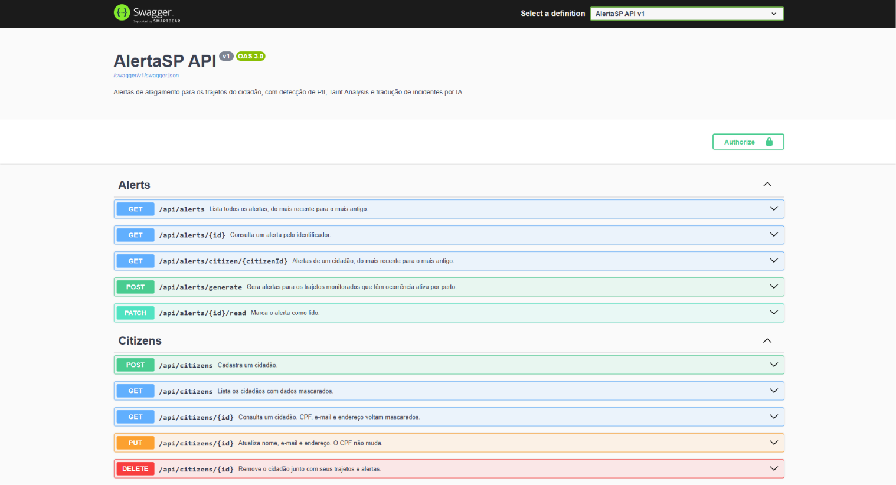
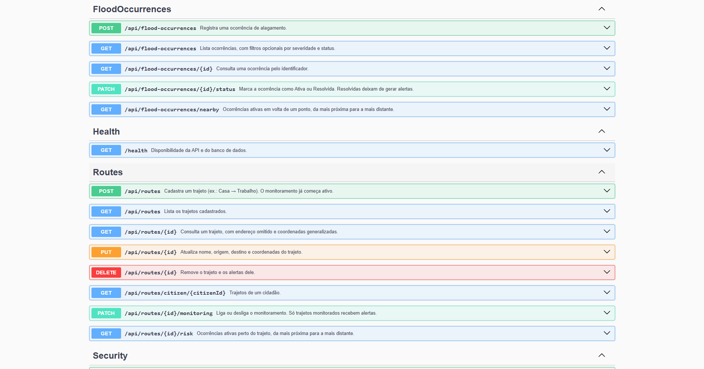
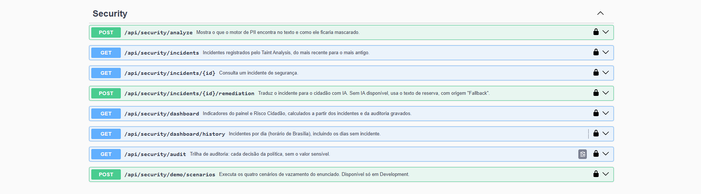

**Health check:** API e banco disponíveis, com cabeçalhos de segurança e `x-correlation-id`.

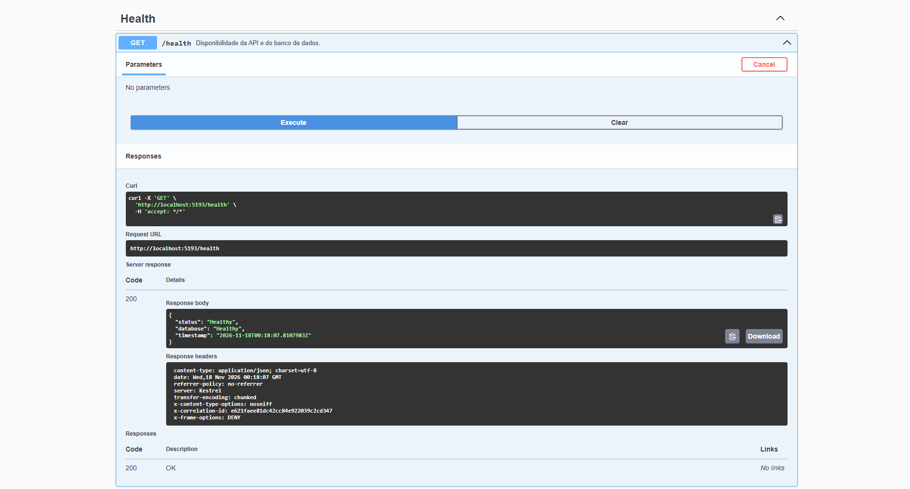

**Cadastro de cidadão (201).** CPF, e-mail e endereço voltam mascarados; no banco ficam cifrados.

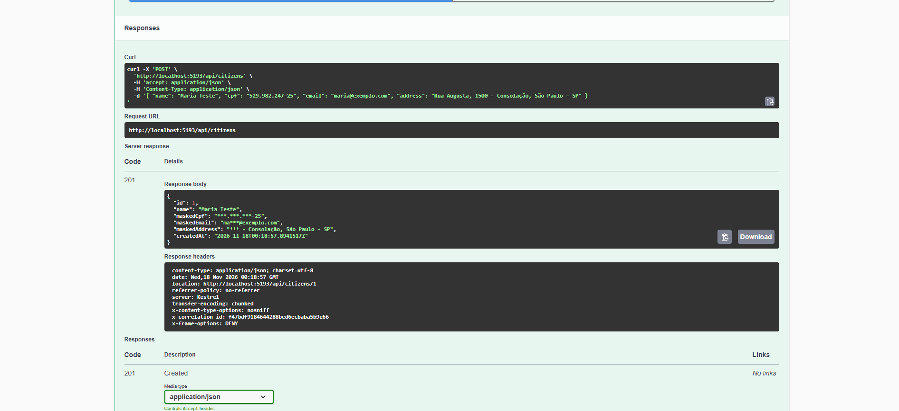

**CPF duplicado (409) e CPF inválido (400)**, os dois em `application/problem+json`.

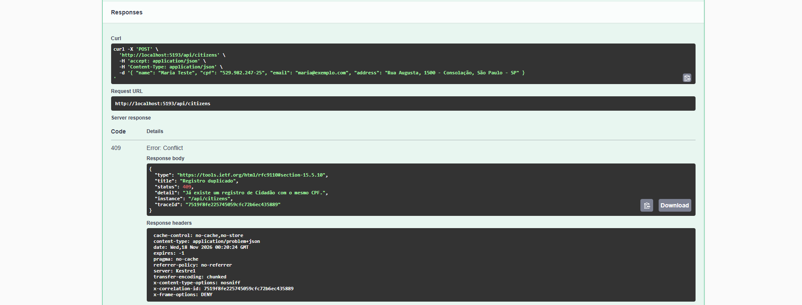
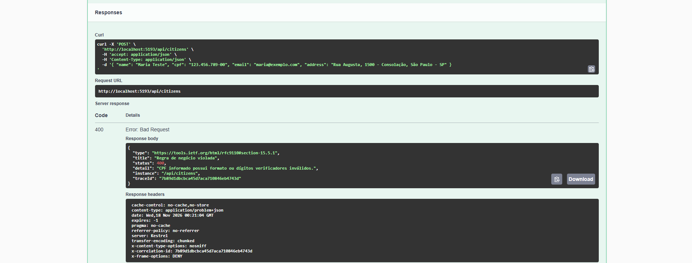

**Trajeto (201).** Na resposta pública, o endereço é omitido e as coordenadas saem com 2 casas decimais.

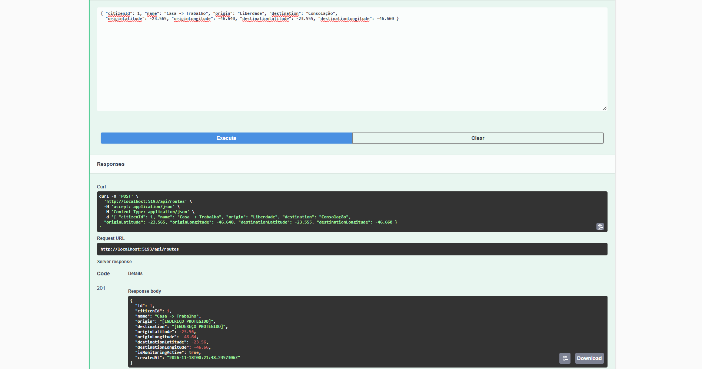

**Ocorrência de alagamento (201)** e **consulta de risco do trajeto:** a ocorrência está sobre o trajeto (0 m), dentro do raio padrão de 500 m.

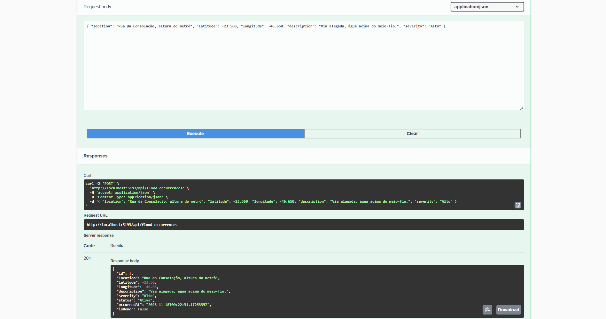
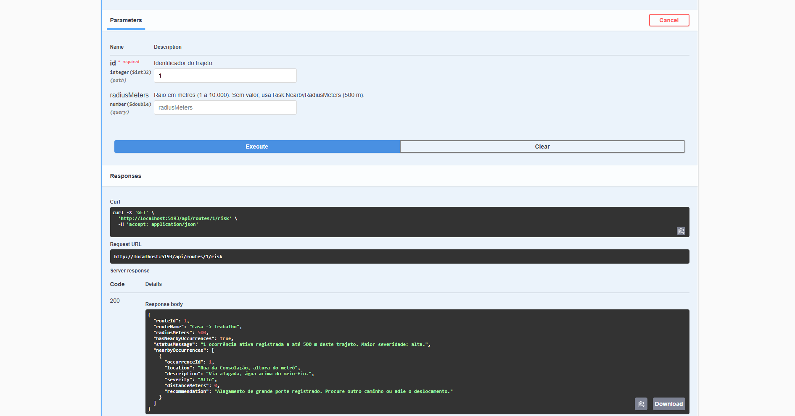

**Geração de alertas:** a primeira execução gera 1 alerta, sem dados pessoais na mensagem; a segunda não duplica.

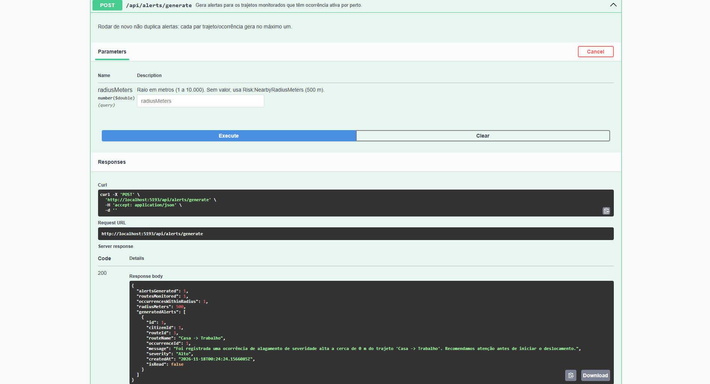
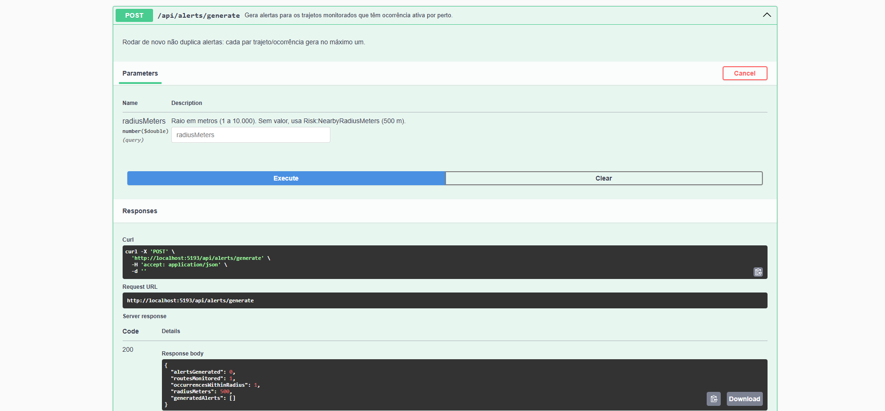

**Alertas do cidadão, paginados.**

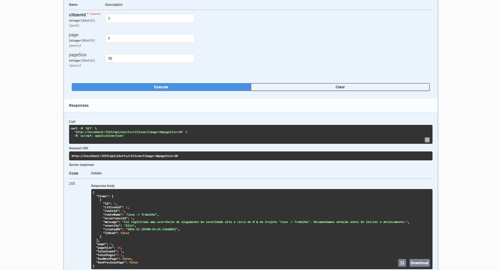

---

## Módulo de segurança

| Parte | O que faz | Detalhes |
|---|---|---|
| Motor de PII | Encontra CPF (validando os dígitos), e-mail, credenciais (pela estrutura, não pela palavra), dados de saúde (por combinação de termos), endereço, CEP e coordenadas. Devolve posição, categoria, sensibilidade e ação recomendada. | [docs/security.md](docs/security.md) |
| Taint Analysis | O dado nasce contaminado (por atributo `[Sensitive]` no DTO ou por detecção no texto), viaja dentro de `Tainted<T>` e só chega a um destino (log, resposta pública, IA externa, banco) depois da decisão da política: liberar, mascarar ou bloquear. Toda decisão vai para a auditoria, sem o valor original. | [docs/taint-analysis.md](docs/taint-analysis.md) |
| Tradução por IA | Transforma o incidente técnico em uma explicação para o cidadão. O prompt leva só a descrição do incidente e passa pelo próprio rastreador antes de sair; a resposta é validada. Sem IA, usa texto de reserva identificado como tal. | [docs/security.md](docs/security.md#tradução-de-incidentes-por-ia) |
| Painel e Risco Cidadão | Indicadores calculados a partir dos incidentes e da auditoria gravados, histórico por dia e o índice de 0 a 100. | [docs/security.md](docs/security.md#indicador-risco-cidadão) |

O vídeo do painel em funcionamento está em https://youtu.be/afiyWpdN1nY: o Risco Cidadão sai de 0, sobe a cada rodada de cenários e as traduções da IA aparecem ao lado do indicador.

Para ver tudo funcionando: abra o painel, informe a chave e clique em **Executar cenários de demonstração**. Os quatro cenários do enunciado rodam pelo mesmo rastreador usado no resto da aplicação (CPF no log, endereço em resposta pública, credencial a caminho da IA e uso interno autorizado), e o indicador sobe na hora. O endpoint de demonstração só existe em `Development`.

O modelo de ameaças está em [docs/threat-model.md](docs/threat-model.md).

---

## Onde cada critério está no código

### C# Software Development

| Critério | Onde ver |
|---|---|
| **POO** | Entidades com setters privados e regras próprias: [Route.cs](src/AlertaSP.Core/Entities/Route.cs), [Alert.cs](src/AlertaSP.Core/Entities/Alert.cs) (`Alert.For` só aceita trajeto monitorado e ocorrência ativa), [Citizen.cs](src/AlertaSP.Core/Entities/Citizen.cs). Polimorfismo: seis implementações de `IPiiRule` compostas pelo [PiiDetectionService.cs](src/AlertaSP.Security/Pii/PiiDetectionService.cs); duas de `ISecurityRemediationService` (IA e texto de reserva). |
| **Interfaces e DI** | Contratos no Core ([Interfaces/](src/AlertaSP.Core/Interfaces/)); registro por camada em `AddApplication`, `AddInfrastructure` e `AddSecurity`; configuração tipada com `IOptions<T>` validada na inicialização ([ProximityOptions.cs](src/AlertaSP.Application/Proximity/ProximityOptions.cs), [CitizenRiskOptions.cs](src/AlertaSP.Security/Risk/CitizenRiskOptions.cs), [AiRemediationOptions.cs](src/AlertaSP.Security/Remediation/AiRemediationOptions.cs)). |
| **Web API** | Controllers finos em [Controllers/](src/AlertaSP.Api/Controllers/): DTOs, validação por atributos, paginação, `ProblemDetails` em todos os erros ([GlobalExceptionHandler.cs](src/AlertaSP.Api/Middleware/GlobalExceptionHandler.cs)), códigos 200/201/204/400/401/404/409, Swagger com descrição de cada endpoint. |
| **EF Core + LINQ** | [ApplicationDbContext.cs](src/AlertaSP.Infrastructure/Data/ApplicationDbContext.cs), uma configuração por entidade em [Configurations/](src/AlertaSP.Infrastructure/Data/Configurations/), índices únicos (hash do CPF; par trajeto/ocorrência), migração em [Migrations/](src/AlertaSP.Infrastructure/Migrations/). Consultas traduzidas para SQL: caixa delimitadora em [FloodOccurrenceRepository.cs](src/AlertaSP.Infrastructure/Repositories/FloodOccurrenceRepository.cs), agrupamentos por categoria e por dia em [SecurityIncidentRepository.cs](src/AlertaSP.Infrastructure/Repositories/SecurityIncidentRepository.cs), contagem por decisão em [AuditEventRepository.cs](src/AlertaSP.Infrastructure/Repositories/AuditEventRepository.cs). |
| **Async/Await** | E/S assíncrona de ponta a ponta (EF Core, HTTP do LLM), com `CancellationToken` repassado do controller ao repositório. Sem `.Result` nem `.Wait()`. |
| **Testes** | 241 testes xUnit: unitários (entidades, serviços, geometria, busca de proximidade, migração, PII, Taint, IA, risco) e de integração com `WebApplicationFactory` e um banco SQLite por teste ([ApiIntegrationTests.cs](tests/AlertaSP.UnitTests/Integration/ApiIntegrationTests.cs)). |

### Cybersecurity

| Critério | Onde ver |
|---|---|
| **Motor de parsing PII** | Regras em [Pii/Rules/](src/AlertaSP.Security/Pii/Rules/), catálogo de saúde configurável em [health-rules.json](src/AlertaSP.Security/Pii/Rules/health-rules.json), mascaramento em [PiiMaskingService.cs](src/AlertaSP.Security/Pii/PiiMaskingService.cs). Testes em [tests/AlertaSP.SecurityTests/Pii/](tests/AlertaSP.SecurityTests/Pii/). |
| **Taint Analysis** | [TaintTracker.cs](src/AlertaSP.Security/Taint/TaintTracker.cs), [SecurityPolicy.cs](src/AlertaSP.Security/Taint/SecurityPolicy.cs) e o uso nos fluxos reais: [CitizenService.cs](src/AlertaSP.Application/Services/CitizenService.cs), [RouteService.cs](src/AlertaSP.Application/Services/RouteService.cs), [FloodOccurrenceService.cs](src/AlertaSP.Application/Services/FloodOccurrenceService.cs), [AlertService.cs](src/AlertaSP.Application/Services/AlertService.cs), [SecureLogger.cs](src/AlertaSP.Security/Logging/SecureLogger.cs). Testes em [tests/AlertaSP.SecurityTests/Taint/](tests/AlertaSP.SecurityTests/Taint/). |
| **IA na remediação** | [LlmRemediationService.cs](src/AlertaSP.Security/Remediation/LlmRemediationService.cs) e [DeterministicRemediationService.cs](src/AlertaSP.Security/Remediation/DeterministicRemediationService.cs). Os testes inspecionam o corpo HTTP enviado ao LLM: [RemediationTests.cs](tests/AlertaSP.SecurityTests/Remediation/RemediationTests.cs). |
| **Dashboard (Risco Cidadão)** | Painel em [wwwroot/index.html](src/AlertaSP.Api/wwwroot/index.html), métricas em [SecurityDashboardService.cs](src/AlertaSP.Security/Dashboard/SecurityDashboardService.cs), fórmula em [CitizenRiskCalculator.cs](src/AlertaSP.Security/Risk/CitizenRiskCalculator.cs). |

Evidências de execução (saída dos testes, prints e vídeo): [docs/evidence/](docs/evidence/).

---

## Arquitetura

```text
src/
  AlertaSP.Core            entidades, enums, exceções e todos os contratos (inclusive os de segurança)
  AlertaSP.Application     casos de uso, DTOs, busca de proximidade
  AlertaSP.Infrastructure  EF Core + SQLite, repositórios, cifragem com Data Protection
  AlertaSP.Security        PII, Taint Analysis, auditoria, IA, Risco Cidadão
  AlertaSP.Api             controllers, middleware, Swagger, painel (wwwroot)
tests/
  AlertaSP.UnitTests       unitários e de integração da API
  AlertaSP.SecurityTests   módulo de segurança (depende só de Core e Security)
docs/                      arquitetura, segurança, Taint Analysis, ameaças, API e evidências
```

Dependências: Core não depende de nenhum projeto; Application e Security dependem só do Core; Infrastructure depende de Core e Application; a Api junta tudo. Como os contratos de segurança ficam no Core, a Application usa o rastreador sem conhecer o projeto Security, e o par Core + Security compila e é testado sozinho. Mais detalhes em [docs/architecture.md](docs/architecture.md).

## Decisões e limitações

- **Trajeto como segmento reto.** A distância é calculada até a reta entre origem e destino (projeção equiretangular, raio padrão de 500 m). Não há roteamento pelas ruas reais.
- **Ausência de ocorrência não é segurança.** Sem registros perto do trajeto, a API diz que não há ocorrência registrada, nunca que o caminho é seguro.
- **Sem login de usuário.** O protótipo não tem autenticação de cidadãos; só os endpoints de segurança exigem chave. As listagens públicas devolvem apenas dados mascarados.
- **Nome do cidadão não é mascarado.** É o dado que a pessoa usa para reconhecer o próprio cadastro; CPF, e-mail e endereço são protegidos.
- **Chaves de cifragem locais.** As chaves do Data Protection ficam no perfil do usuário do Windows. Em produção iriam para um cofre de chaves.
- **Detecção de saúde por texto** reduz falsos positivos exigindo combinação de termos, mas não garante encontrar todo dado médico.
- **Dados meteorológicos** ficam como evolução futura.
- **.NET 9** já saiu do período de suporte da Microsoft; o projeto mantém a versão definida no início do semestre.
